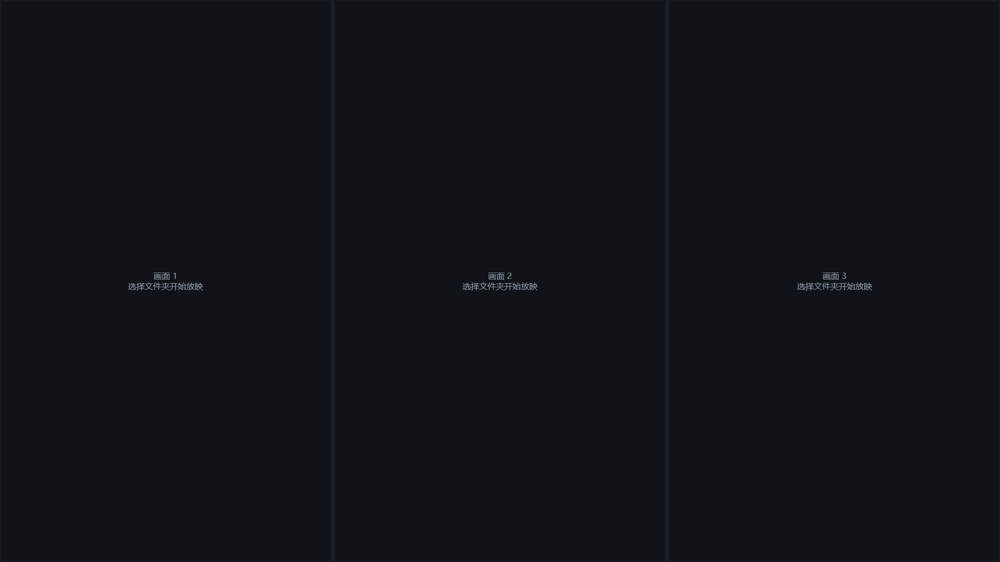

# 三境

一个轻量的 Windows 三画面图片放映器。适合在同一块屏幕上同时查看三组照片、作品或素材。

三块画面各有独立计时器、独立文件夹和独立播放状态。可以拖动分隔线调整宽度，也可以让其中一块画面单独全屏。



## 功能

- 三个竖向画面，可自由拖动分隔线调整宽度。
- 每块画面独立选择文件夹、独立自动播放、独立暂停。
- 自动递归读取图片，按文件名排序。
- 当前文件夹播放结束后，从同级文件夹中随机选择一个含图片的文件夹继续。
- 鼠标滚轮在哪个画面内滚动，就只切换该画面。
- 双击画面单独全屏，`Esc` 返回三画面。
- 无边框整屏放映，鼠标静止后自动隐藏。
- 右键菜单支持定位当前图片、随机切换文件夹、调整速度和移入回收站。
- 图片从原位置读取，不复制、不修改、不上传。

## 系统要求

- Windows 10 或 Windows 11，x64
- [.NET 8 Desktop Runtime](https://dotnet.microsoft.com/download/dotnet/8.0)

## 使用

双击 `SanJing.exe`。第一次启动时，分别点击三个画面选择文件夹即可开始播放。

也可以在命令行传入一个总文件夹：

```powershell
SanJing.exe "D:\Photos" --interval=5
```

`--interval` 表示每张图片停留的秒数。

### 鼠标操作

| 操作 | 作用 |
| --- | --- |
| 左键单击空白画面 | 选择该画面的文件夹 |
| 鼠标滚轮 | 切换鼠标所在画面的上一张/下一张 |
| 双击画面 | 该画面单独全屏 |
| 右键画面 | 打开画面菜单 |
| 拖动中间分隔线 | 调整画面宽度 |
| `Esc` | 从单画面返回三画面 |
| `空格` | 暂停或继续当前画面 |

### 右键菜单

- **选择文件夹**：更换当前画面的图片目录。
- **定位到当前图片**：在资源管理器中选中当前图片。
- **随机切换同级文件夹**：从当前文件夹的同级目录随机换一组照片。
- **移入回收站**：删除当前文件夹前会二次确认，可随时从 Windows 回收站恢复；总目录本身禁止删除。
- **播放时自动隐藏鼠标**：可在窗口右键菜单中关闭。

## 从源码运行

```powershell
dotnet build -c Release
dotnet run -c Release
```

构建发布包：

```powershell
dotnet publish -c Release -r win-x64 --self-contained false -o dist
```

单文件发布默认依赖本机 .NET 8 Desktop Runtime。若需要免安装运行，可改为：

```powershell
dotnet publish -c Release -r win-x64 --self-contained true -p:PublishSingleFile=true -o dist
```

## 隐私

三境只访问你主动选择的本地文件夹。图片不会上传，也不会写入日志；仅保存本次运行中的播放状态。

## 许可证

MIT
